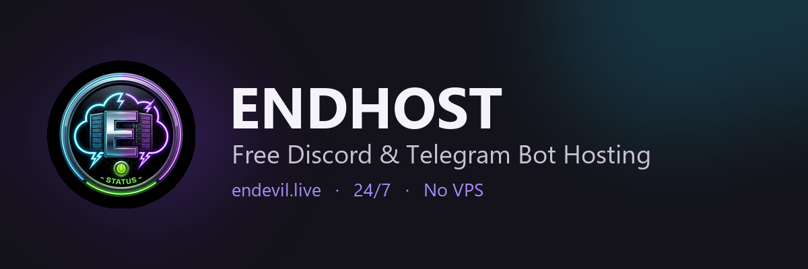
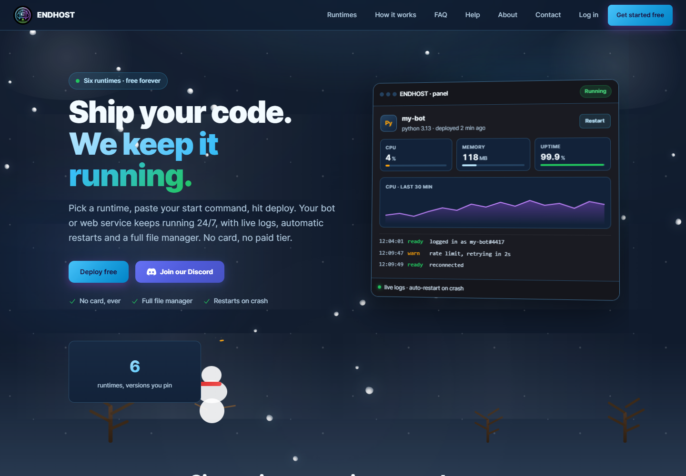
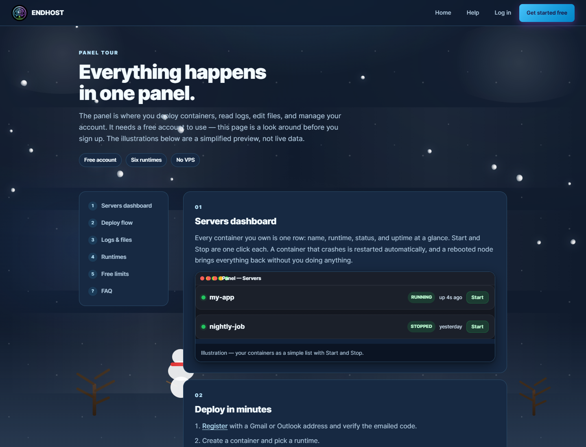

# Free Discord & Telegram Bot Hosting

ENDHOST is free bot hosting for Discord and Telegram. Upload your code, pick a runtime, press Start, and your bot stays online 24/7 — no VPS and no PC left running.

[**Start hosting free →**](https://endevil.live) · [Setup guide](https://endevil.live/help) · [Panel tour](https://endevil.live/tour) · [Discord](https://discord.gg/RNVJeMKDAV)

## A look inside

| Homepage | Panel tour |
|:---:|:---:|
|  |  |

## What you can host

**Discord bots** — discord.py, discord.js, nextcord, disnake, Sapphire, Eris, or any library that runs on a supported runtime.

**Telegram bots** — python-telegram-bot, aiogram, Telegraf, grammY or Telethon. Use long polling; webhooks aren't supported.

Node.js, Python, Ruby, Go, PHP and Bun are all supported.

## What you get

- Free 24/7 hosting — no trial, no credit card
- Live logs and a file manager
- Automatic restarts if your bot crashes
- No SSH or server maintenance
- Your code and token stay yours

## Get started

1. Create a bot in the [Discord Developer Portal](https://discord.com/developers/applications) and copy the token.
2. [Make a free ENDHOST account](https://endevil.live/user/register).
3. Upload your code, choose a runtime, set the startup command, and press **Start**.

Telegram bots use the same flow. That's it — your bot is live.
